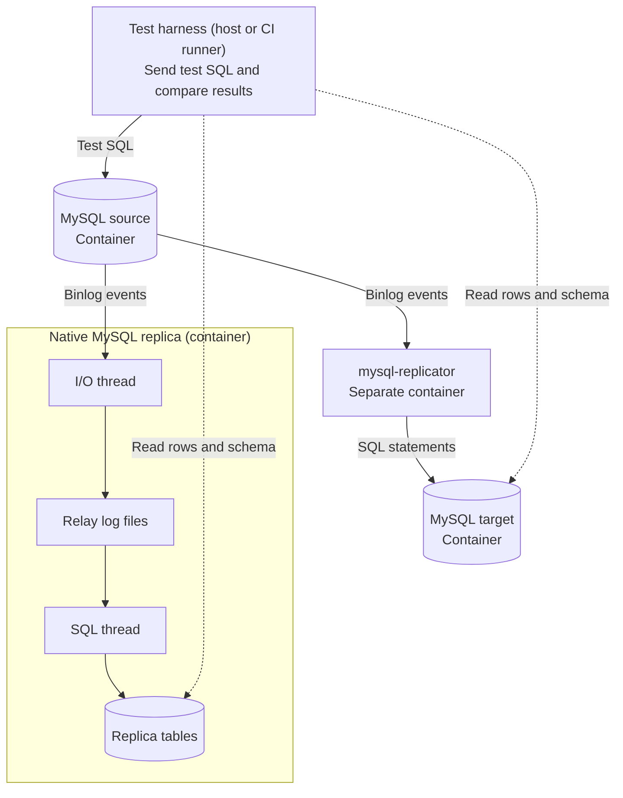

# mysql-replicator

[](https://github.com/GannettDigital/mysql-replicator/actions/workflows/ci.yml)
[](LICENSE)

`mysql-replicator` replicates changes between MySQL instances, including version
combinations that native MySQL replication does not support. For example, it can
keep a MySQL 5.7 MyISAM replica in sync with a MySQL 8.4 InnoDB source.

This tool is for DBAs, data engineers, and platform engineers who operate MySQL
replicas. It reads source binlogs, decodes row events outside MySQL, and applies
row changes and supported DDL through a target SQL connection.

## Use cases

- **Keep legacy replicas:** upgrade a primary to 8.4 while a system still needs
  a 5.7 replica.
- **Replicate across an upgrade gap:** copy changes from 5.7 directly to an 8.4
  target. The initial data copy and server upgrades remain external tasks.
- **Test an upgrade:** restore a snapshot to a newer server, then replay binlogs
  from the application workload. Stop at a selected GTID boundary. Configure
  the tool to skip selected errors and continue, so you can find more
  incompatibilities.

Replay tests the recorded row changes and DDL. It does not replay SELECT queries
or recover the original application statements from row events. The tool can
skip only the error types listed in the [error handling guide](docs/OFFLINE_REPLAY.md).
Skipped changes can affect later results; the DBA must assess the resulting
differences.

## How cross-version replication works

Many row changes from MySQL 8.4 use types and operations that MySQL 5.7 supports.
An external decoder can turn those events into SQL that 5.7 accepts. The target
does not need to decode the source binlog itself.

Native replication includes its decoder and event handlers in the MySQL server.
An older server can read some newer binlog events, but new event formats, SQL
features, and changed behavior can prevent replication. MySQL generally does not
support replication from a newer source to an older replica. See the
[MySQL compatibility rules](https://dev.mysql.com/doc/refman/8.4/en/replication-compatibility.html).

External decoding does not remove differences in SQL or data semantics. For
example, MySQL 5.7 has no `utf8mb4_0900_ai_ci` collation. Use compatible schemas
or enable an explicit [collation mapping](PLAN/DDL_COMPATIBILITY.md#optional-collation-translation-and-table-replacement).
A mapping can change comparisons, sort order, and unique-key behavior. It is not
a general conversion for all MySQL 8.4 features.

## Tested profiles

A configuration profile selects the source version, target version, and target
storage engine. The test suite checks these four combinations:

| Configuration profile | Source | Target | Foreign keys |
| --- | --- | --- | --- |
| `mysql84-to-mysql57-myisam` | MySQL 8.4 InnoDB | MySQL 5.7 MyISAM | Not supported |
| [`mysql57-to-mysql84-innodb`](docs/REVERSE_REPLICATION.md) | MySQL 5.7 InnoDB | MySQL 8.4 InnoDB | Supported with [limits](PLAN/MYSQL57_FOREIGN_KEYS.md) |
| [`mysql57-to-mysql57-myisam`](docs/MYSQL57_MYISAM.md) | MySQL 5.7 InnoDB | MySQL 5.7 MyISAM | Not supported |
| [`mysql57-to-mysql57-innodb`](docs/MYSQL57_INNODB.md) | MySQL 5.7 InnoDB | MySQL 5.7 InnoDB | Supported with [limits](PLAN/MYSQL57_FOREIGN_KEYS.md) |

Set `profile` in your YAML configuration to select a profile. Other combinations
are not tested. See [DML support](PLAN/DML_APPLY.md) and
[DDL support](PLAN/DDL_COMPATIBILITY.md) for the supported operations and limits.

Copy the initial data with an external tool. If a write fails or the tool cannot
confirm whether it completed, a DBA may need to repair the target before
replication continues.

## Features

- **Live replication:** start from a GTID set or binlog file position. Stop cleanly
  and resume from the saved replication position.
- **Offline replay:** fetch binlogs or use a directory of raw files from
  `mysqlbinlog`. Replay does not connect to the source. Stop after a transaction
  count or when the applied GTID set contains `source.stopAfterGTIDs`.
- **Process control:** use `ctl status`, `ctl stop`, and `ctl reload`. Reload
  supports changes to selected limits, such as when to stop replication. It does
  not replace the saved replication position.
- **Disconnects and restarts:** reconnect to the source or target when the saved
  state permits continuation. If the tool cannot confirm whether a target write
  completed, it stops replication for DBA review.
- **Selection and error handling:** exclude tables with wildcard rules. Skip
  selected errors in live or replay mode. You can record each skipped transaction
  or disable these records. The DBA remains responsible for data consistency
  after a skip.
- **Statistics and troubleshooting:** collect transaction and row counts, plus
  time spent downloading, decoding, and applying binlog events. Export logs,
  configuration, and saved state as a **support bundle** for troubleshooting.
  Create a bundle manually or enable automatic collection when an error stops
  replication in the `BLOCKED` state.

See the [configuration reference](examples/apply.example.yaml),
[replay and control guide](docs/OFFLINE_REPLAY.md), and
[filter rules](PLAN/WILDCARD_FILTERS.md). State records help a DBA investigate
failures. They do not guarantee automatic recovery when the outcome of a target
write is unknown.

## Install and start

Download a binary archive or Debian `.deb` package from [Releases](https://github.com/GannettDigital/mysql-replicator/releases).
**Binaries and containers support Linux x86_64 only.**
For other platforms, build from source. You do not need to install Swift, Rust,
Node.js, or SQLite to use the binary. The installer needs `curl`, `jq`, `tar`,
and coreutils. To install the latest published release, run:

```sh
curl -fLo install.sh https://raw.githubusercontent.com/GannettDigital/mysql-replicator/main/packaging/install.sh
sh install.sh
~/.local/bin/mysql-replicator --version
```

Follow the [setup guide](docs/INSTALL.md) to prepare the target and record the
source position for the initial data copy. Configure connection security and credentials in
`apply.yaml`.

Use the short example for [live replication](examples/run.minimal.yaml) or
[offline replay](examples/replay.minimal.yaml). The [full example](examples/apply.example.yaml)
describes the optional settings. To start live replication, run:

```sh
~/.local/bin/mysql-replicator run --config ./apply.yaml --initialize
```

The installer selects the latest published release, including beta releases.
It checks the archive checksum and keeps the configuration and state.
Pass `--version VERSION` to `install.sh` to select a specific release.
Use `mysql-replicator COMMAND --help` for command options. See the
[command-line reference](docs/COMMAND_LINE.md).
Use `--initialize` only for the first start. Omit it to resume saved state.

For Debian or Ubuntu, download the `.deb` and `SHA256SUMS` files for the selected
release. Put them in a directory with no other package versions.
Check the checksum. Then install the package:

```sh
sha256sum --ignore-missing --check SHA256SUMS
sudo apt install ./mysql-replicator_*_amd64.deb
```

The package installs `mysql-replicator` on `PATH` and includes a systemd service.
Follow the [Debian installation and service setup guide](docs/INSTALL.md#download-and-verify)
to configure, start, and restart the service. The setup guide also describes containers.
See [offline replay and support bundles](docs/OFFLINE_REPLAY.md) to test captured
binary logs against a prepared target and collect data for troubleshooting.

## Deployment requirements

`mysql-replicator` runs as a daemon or service. The Linux release is a standalone
binary with no language runtime, database client, or separate SQLite installation.
It connects directly to MySQL. It does not require Kafka, Pub/Sub, or a separate
state database server.

The source binlog is the change history. Unapplied changes can be downloaded
again while the source retains them. Keep enough binlog retention for the
expected outage and replication lag, or keep an external archive.

Local files hold the last applied GTID and binlog position, table definitions,
and binlog events waiting to be applied. They also hold records of failed or
interrupted writes to help a DBA investigate and repair the target. Configuration
limits control how much binlog data the tool retains for replication. Archived
binlogs and support bundles need additional disk space.

Put `stateDirectory` on a durable POSIX filesystem with working locks, atomic
renames, and `fsync`. Use a local filesystem on persistent block storage, mounted
by one `mysql-replicator` process. The tool stores its replication state in
SQLite, which uses [WAL mode](https://www.sqlite.org/wal.html).
Do not use an object-storage FUSE mount for active state. For example,
[Cloud Storage FUSE](https://docs.cloud.google.com/storage/docs/cloud-storage-fuse/overview#limitations)
is not POSIX compliant and does not support file locking.

## Comparison with migration and CDC tools

| Tool | Main workflow |
| --- | --- |
| [Google Cloud Database Migration Service (DMS)](https://docs.cloud.google.com/database-migration/docs/mysql/migration-types) | Managed migration: initial dump/load, followed by continuous replication and promotion of the destination |
| [Debezium](https://debezium.io/documentation/reference/stable/connectors/mysql.html) and [Maxwell](https://maxwells-daemon.io/producers/) | Change data capture (CDC): decode database changes and publish events to downstream systems, often through a durable broker such as Kafka or Pub/Sub |
| `mysql-replicator` | Apply MySQL changes directly to MySQL, or replay an archive against a prepared target with controls to stop, resume, and skip selected errors |

## Testing approach

The test harness runs on the host or CI runner. It starts four main containers
and sends SQL statements to the source. Native MySQL replication and
`mysql-replicator` apply the same source changes to separate replicas. The
harness reads both replicas and compares their rows and schema definitions.



The native replica uses the same MySQL version as the source. The external
applier and its target run in separate containers. The harness also checks saved
replication positions and the expected behavior after errors. Selected tests use
`mysqlbinlog` to compare the changes recorded in source and replica binlogs.
These comparisons exclude server-specific values, such as server IDs.
Some tests use additional helper containers.

| Area | Tested cases |
| --- | --- |
| Row changes | INSERT, UPDATE, DELETE, multiple rows, primary-key changes, upsert, REPLACE, IGNORE, INSERT SELECT, joined updates/deletes, and LOAD DATA as row events |
| Data types | Signed/unsigned integers, DECIMAL, date/time types, CHAR/VARCHAR, binary strings, TEXT/BLOB families, ENUM, SET, and NULL values |
| Keys and transactions | Composite primary keys, secondary and unique indexes; InnoDB multi-statement transactions and foreign keys within the profile limits |
| DDL | Database create/alter/drop; table create/alter/drop, LIKE, rename, truncate, column and index changes, defaults, generated columns, partitions, views, and stored routines within the supported SQL syntax |
| Process control and failures | Starting positions, resume from saved state, source/target restarts, table filters, selected error skips, offline replay, and support bundles |

This is a test summary, not a claim of complete MySQL compatibility. MyISAM
profiles accept one DML statement per source transaction, affecting one table
that is not excluded by the table filters. Tables need primary keys that meet
the [DML requirements](PLAN/DML_APPLY.md). JSON and spatial columns are not
supported. [BIT](PLAN/BIT_SUPPORT.md) and [FLOAT/DOUBLE](PLAN/FLOATING_POINT_SUPPORT.md)
have unit tests; their shared integration tests have not yet run. Other untested behavior is not necessarily
unsupported. Check the [test inventory](docs/TEST_LAB.md),
[DML limits](PLAN/DML_APPLY.md), [large-value limits](docs/LARGE_VALUES.md),
and [DDL limits](PLAN/DDL_COMPATIBILITY.md).

This project uses **AI-assisted development with human review and direction**.
AI agents write much of the code. A human directs the work, reviews decisions,
and evaluates test evidence.

Unit tests, error-path tests, and demo workflows provide additional evidence.
Coverage reports show which code ran. Test reports show which MySQL operations
and failure scenarios passed for each profile. These checks provide evidence
for the tested behavior; code generation alone does not establish correctness. See the [test lab](docs/TEST_LAB.md) and
[release test process](docs/RELEASE_TESTING.md).

## Try the demo

Get a copy of the source and install the [developer prerequisites](CONTRIBUTING.md#prerequisites).
Then run:

```sh
make lab-demo PROFILE=mysql84-to-mysql57-myisam ACTION=up
make lab-demo PROFILE=mysql84-to-mysql57-myisam ACTION=start
```

Use the [test lab guide](docs/TEST_LAB.md) to run SQL, compare replicas, select
another profile, or see which cases the test commands run. To remove the demo, use the same profile with `ACTION=down`.
Run a small set of correctness tests with `make correctness TIER=smoke`.
The [forward workbook](PLAN/DEMO_WORKBOOK.md) and
[reverse workbook](PLAN/REVERSE_DEMO_WORKBOOK.md) give more examples with the same commands.

[Build, test and contribute](CONTRIBUTING.md) · [Security](SECURITY.md) ·
[License](LICENSE) · [Third-party notices](NOTICE)

Copyright 2026 USAToday Co., Inc.
